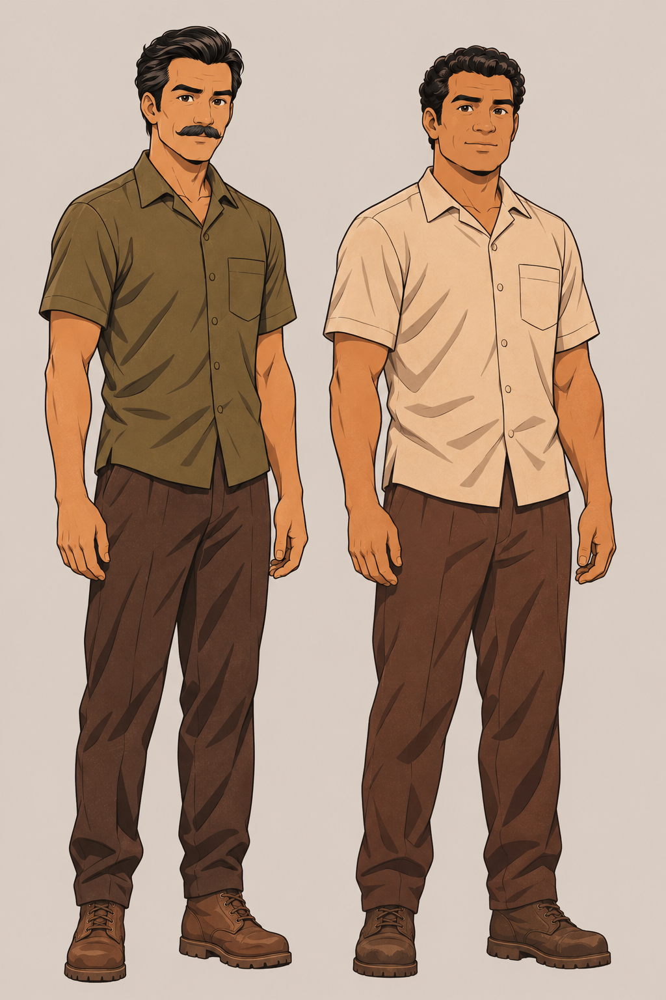
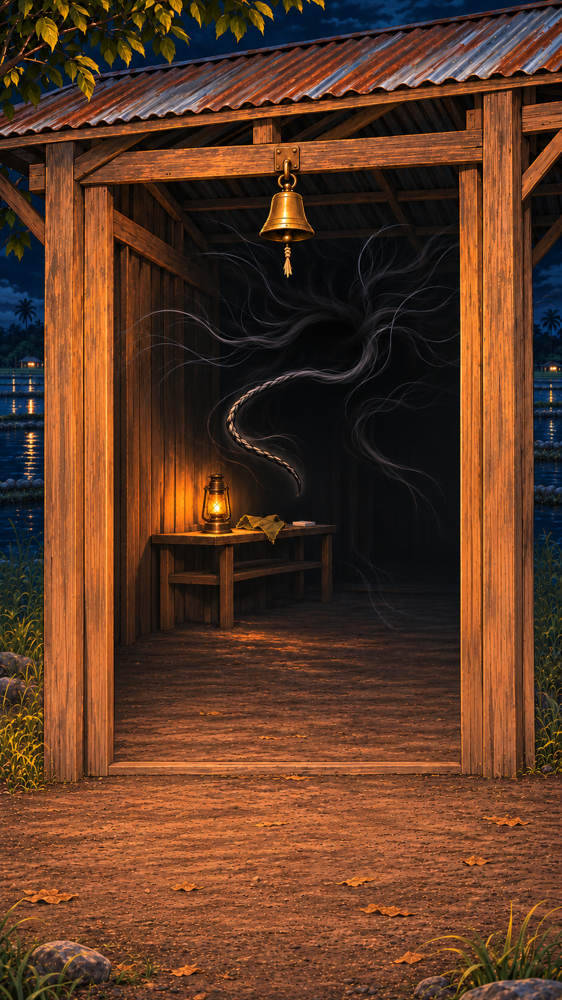

# Beauty and Bagwis — Episode 5 memory-fight brief

## Purpose

Use this Markdown and the supplied reference images to develop video prompts on another platform. This is the intended choreography and story, not a description of accepted finished footage. Do not inherit the staging errors or long guard holds from previous generated tests.

The fight opens Episode 5 as a memory. Young Tomas and Bagwis’s father are attacked at an old fishpond watch shed. The enemy is stronger and harder to strike than an ordinary person. The father chooses to save Tomas instead of taking a clear chance to escape. Their survival establishes the friendship and debt behind Tomas’s present-day confession. The enemy is not identified or conclusively defeated.

## Fixed visual and production choices

- Original Filipino romantic-supernatural drama. Refined **2D comic/anime illustration**, bold clean black ink outlines, flat cel shading, warm earthy colors, detailed painterly realistic 2D provincial environments.
- Portrait **9:16**, **480p**. Seedance 2.5 Flash R2V remains the selected generation model; verify actual controls/quotes on the platform used.
- Cinematic trailer-style action: urgent ordinary real-time movement, connected attack/response/counter, meaningful changes of angle, forceful impacts. No slow motion, prolonged wind-up, repeated attack at cuts or held victory poses.
- No combat dialogue, narration, music, captions or watermark baked into generated action. Keep native material-specific action sounds. Narration, NOON and Kuro Dorama watermark can be added in editing. Later conversation stays Tagalog.
- Intended action footage approximately **35–45 seconds**, subject to readable movement and editing. Do not stretch it to one minute. The first 3–5 seconds are the hook; the rest of the memory can resume after a short present-day exchange without replaying the hook.

## References and their exact roles

### 1. Young characters — primary identity reference

**LEFT: young Tomas**, approximately 35. Olive-green buttoned short-sleeve work shirt, brown trousers, brown boots, swept-back BLACK hair, recognizable moustache. Adult face, younger than present-day Tomas, no gray streaks or current forearm bandage. **One short bolo in his anatomical RIGHT hand**, left hand empty, until the trapping beat explicitly makes him drop it.

**RIGHT: Bagwis’s father**, approximately 34; working name **Isagani Dalisay**. Cream buttoned short-sleeve shirt, brown trousers, brown boots, short tightly curly black hair, broader square face, clean-shaven. He is a separate person from Bagwis and Tomas. **One plain long wooden staff held in BOTH hands**, until its late break. No new human powers or transformation.

The image controls faces, hair, body proportions, clothes and colors. Its neutral standing poses and blank background must NOT become fight choreography. Ages are approximate design guidance, not a newly fixed timeline. Character placement can change through visible footwork; never silently swap their identities, hands or clothes.

### 2. Hair-like smoke enemy and night shed

An indistinct presence is concealed inside the dark shed. Long, fine charcoal-black smoke tendrils flow like loose strands of hair underwater. Several strands braid together into **one whip-like striking tendril**; the short curved tip condenses into brittle matte-black solid material immediately before contact. After the strike, it loosens and unravels into smoke again. Other thin strands trail passively rather than making simultaneous attacks. Subtle cold rim light makes strands legible against the darkness.

No visible enemy face, glowing eyes, claw hands, full monster body, fleshy horn, rubber hose, white smoke tornado or human-shaped opponent. The hair-like appearance is a visual design, **not a reveal that this is a known folklore creature or someone’s literal hair**. Do not name the controller or invent a new mythology rule.

The reference also establishes the timber doorway, brass bell, rear bench lantern and dry dirt entrance. Lantern warmth and cool night remain consistent. No humans are in this image, so it cannot override character identities or prescribe standing poses.

### 3. Side platform and rescue geometry

A low maintenance platform beside the RIGHT exterior wall overlooks a shallow overflow channel. A short ramp connects it to the dirt entrance. A damaged outer rail support holds one low horizontal wooden timber. A flat firm stone sits nearby on the platform and can act as a lever pivot. The exit leads to dry ground.

This is a proposed extension of the established location. **Show it before the trap uses it.** The dirt doorway stays dirt; do not replace it with indoor floorboards. The dropping timber comes from the visible LOW RAIL, not a newly invented roof beam. Keep rail, stone, channel and exit in the same positions across shots.

## Combat logic

1. A blade passes through the enemy’s loose smoky strands without a solid hit. That failed slash demonstrates the problem.
2. Physical contact is possible during the brief hardened striking phase. Show strands tighten, the tip travel, contact occur, and then the material loosen/recoil. This is a provisional visual fight mechanic, not exposition explaining the creature.
3. The men depend on footwork, timing, weapons and the environment. No unexplained super-strength, lightning, teleportation, aerial flight, glowing sword power or blood pact.
4. The enemy’s pressure drives the geography change; the men do not stop fighting to walk to a new set.
5. Protect and escape is the outcome. The channel displacement buys time; **water is not established as killing or weakening the enemy**.

## Fight progression and cinematic shots

Times below are edit estimates, not precise frame controls. Cut on movement, not because a timestamp demands a new angle. Each essential contact must remain readable. Allow the trap and lever more time than a quick blow.

| Beat | Approximate screen time | Visible action | Camera purpose |
|---|---:|---|---|
| 1 — Cold opening | 1.5–2 s | Tomas is already stepping into one short right-handed slash through loose smoke. The blade parts the strands; no resistance. His failed strike carries him straight into an evasive step. Father advances in support with staff already moving. | Low three-quarter wide establishes both younger faces, weapons, doorway and threat. No neutral lineup. |
| 2 — Immediate consequence | 1.5–2 s | The strands braid, hard tip sweeps toward Tomas. He ducks below it. It misses him and strikes the post behind his former head position; small splinters follow contact. | Tight side angle includes head, attack lane and post. Cut during the duck, no replay. Add NOON in editing during hook. |
| 3 — Rescue intervention | 2–3 s | The tip springs back toward Tomas. Father enters the attack lane and intercepts with the middle of his two-handed staff. His elbows compress, shoulder rotates, rear boot skids a short distance and pushes dust. He immediately redirects the tip. | Perpendicular side medium-wide shows tip touching staff, hands and feet. **Tomas must be clearly BEHIND and OUTSIDE the contact line**, not aligned with the staff tip. |
| 4 — The clue | 0.7–1 s | A single thumbnail-sized curved black fragment chips from the hardened enemy tip during the staff contact, falls to dry dirt and settles. Neither man picks it up. | Optional matched contact close-up, then brief low landing insert. Do not repeat the same collision twice. Fragment about 2 cm, not a large horn. |
| 5 — Moving pressure | 3–4 s | The enemy recoils/unbraids and returns in one low sweep. Tomas steps off the line with bolo still in right hand while father’s deflection opens a narrow retreat. Both move from dirt threshold toward the side ramp and platform, with attacks continuing to press them. | Lateral tracking wide establishes rail support, timber, stone and channel BEFORE failure. No pose reset or instantaneous relocation. |
| 6 — Support fails | 1–2 s | A hard tendril strike hits the already damaged rail support. Wood splits and its low horizontal timber begins to drop. | Mechanical side close-up includes support, timber and threatened leg position. Support failure precedes falling timber. |
| 7 — Tomas trapped | 2–3 s | Tomas loses footing beside the falling rail. Timber pins his anatomical RIGHT lower shin against platform planks without gore or unnatural joint bend. Bolo drops from right hand onto clear planks, away from him. Left leg stays free. | Side-wide: show fall, two distinct legs, beam contact and final trapped position. One clear mechanical event. |
| 8 — The choice | 1–2 s | Father has a clear exit but pivots straight back to Tomas. He crouches into rescue work, not a prolonged look between exit and friend. | Brief moving medium view, exit and trapped friend readable. The choice is conveyed by movement. |
| 9 — Lever rescue | 4–5 s | Father puts lifting end of intact staff UNDER the timber. Staff midpoint rests ON the fixed stone; both hands press DOWN on free end. Timber rises only enough for Tomas to pull RIGHT leg clear. Timber drops away only after leg is clear. | Stable low side angle shows staff–stone–timber relationship and leg withdrawal. Staff never presses on Tomas’s leg. Use this geometry even if an illustrative panel is imperfect. |
| 10 — Cost of escape | 3–4 s | Before they can settle, the tendril attacks again. Father blocks; staff snaps once. His parry redirects the rushing tendril and attached concealed smoky mass through the already damaged rail into the shallow channel. | Medium-wide establishes attack, staff break and outward momentum. Water splashes AFTER entry. Avoid detailed full monster reveal or implying death. |
| 11 — Leave together | 3–4 s | Father drops remaining broken wood clear of their feet. Tomas’s RIGHT arm rests across father’s shoulders; they move urgently toward dry exit. Tomas favors freed RIGHT leg. Bolo stays behind; no automatic return to his hand. | Side tracking, natural two-person support, visible feet, no heroic slow walk or posed embrace. |
| 12 — Danger remains | 0.7–1 s | A faint hair-like charcoal disturbance remains in channel shadow as both men keep moving away in the background. | Short low water detail; no face, eye reveal or named culprit. Optional final ominous insert, no long landscape hold. |

## Impact and camera direction

- Every clash follows **incoming trajectory → visible contact → recoil/displacement → immediate continuation**. A camera shake or flash alone is not a hit.
- Staff collision: wood vibration, compressed elbows, rotating shoulder, brief dirt skid. Blade against a hardened tip: brief arm recoil and dark fraying/chip, not metal welding sparks.
- At most two very brief LOCAL drawn white slash/impact accents on the strongest TRUE contacts. Immediately return to normal image. No full-screen strobe, sustained flashing, magical human beam or slow-motion freeze.
- Keep faces and contact legible; small motion blur can trail blade tips and smoke strands. Do not blur away faulty grips.
- Use low wide, perpendicular side medium, motivated contact detail, ground insert and lateral tracking views. One main camera movement per shot. Preserve action direction across cuts; no uncontrolled orbit or random axis flip.
- Key correction from failed tests: **never put the staff’s impact flash over Tomas’s chest**. Put the incoming enemy tip visibly between staff and enemy source, with Tomas safely offset behind the defender.
- Match the movement at cuts. Do not replay the slash/block from a second angle as another attack. Cut idle footage; do not change playback speed to hide slow choreography.

## Sound and performance

Native action sound follows actual visible material contact: blade/tendril swish → wood crack/vibration or brittle black-tip tick → foot scrape/dust → water entry/splash. Keep sound bridges across cuts. No speech during fighting. Faces show fear, exertion and determination without overacting mouths, talking animation or repeated head bobbing.

After escape, generate a separate naturally breathless Tagalog exchange if needed:

**Young Tomas:** “May pagkakataon kang makaalis. Bakit mo pa ako binalikan?”

**Bagwis’s father:** “Kaibigan kita, Tomas. Hindi naman kailangan ng kapalit ’yon.”

Use the established dialogue workflow/voice review for those lines. Do not give silent fight takes these words to recite accidentally.

## Continuity that must survive every cut

- This is an OLD rescue by **Bagwis’s FATHER**, not Bagwis’s recent rescue of an unconscious Tomas. Young designs, no aging transition during action.
- Tomas’s OLD injury here is RIGHT lower leg. Do not add the present-day LEFT forearm wound/bandage, explain its healing, or introduce a bite/blood exchange.
- Tomas’s bolo is right-hand only until dropped; father’s one staff stays intact until the final break; broken pieces never reconnect.
- One hair-smoke enemy, one attacking braided tendril at a time; trailing wisps are not extra attackers.
- One curved black clue on dirt, unchanged after landing. It does not levitate, become a giant horn, move to platform or return to the enemy. Inspect exact scale/material against the current-story clue.
- Rail damage accumulates; the stone does not slide or vanish; staff lever needs actual stone contact and a lifting end under the timber.
- Both men survive the shown sequence. Do not invent confirmed death, missing-person identity, blood relationship, the enemy’s controller or a new power revelation.

## Using this handoff in another prompt-writing tool

Supply this Markdown plus references 01–03. Ask the tool to produce short linked shot prompts and, optionally, one compact multi-shot version, preserving the story and asset roles. Each generated segment needs explicit start/end positions, facing, distance, momentum, damage and weapon grips. Treat timings as a plan, not a promise of model precision.

Primary references control identity, enemy and geography. The optional storyboard grids control composition/shot ideas only: they were made BEFORE the final hair-like enemy redesign and some limb/mechanical details remain illustrative. Do not use their older thick appendage as enemy design, inherit a wrong weapon hand, or copy imperfect lever contact over the mechanical instructions above. Their panel numbers are not identical to the beat numbers in every earlier pack.

No prompts or footage are generated by this document. Existing failed test clips are deliberately excluded from reference assets so their staging does not become the new baseline.
