# Reference gallery — clips06–16

Click an image to open the full PNG. Use its matching clip number as @image1.

## Clip 06

[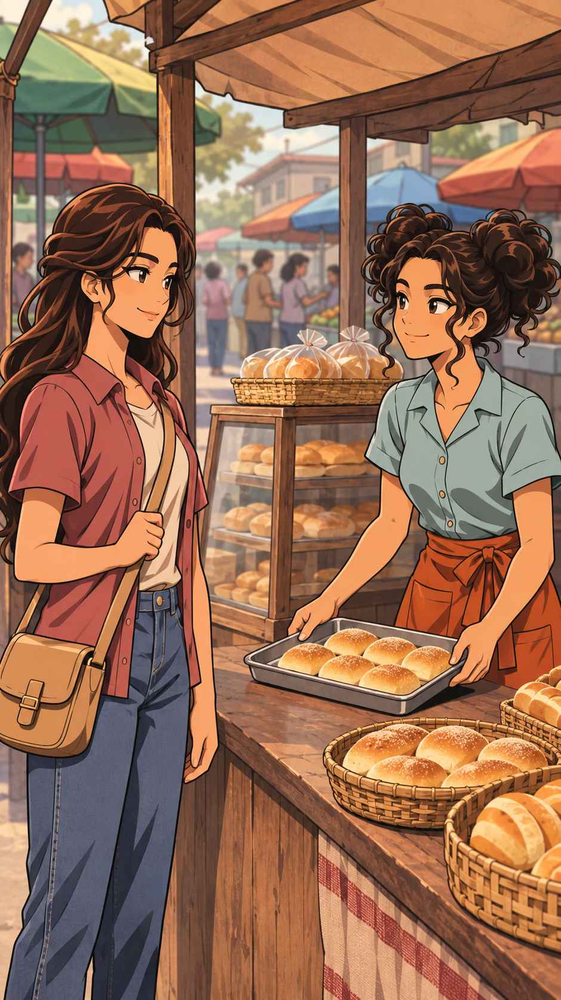](Clip-06-Bakery-Beauty-Ning.png)

## Clip 07

[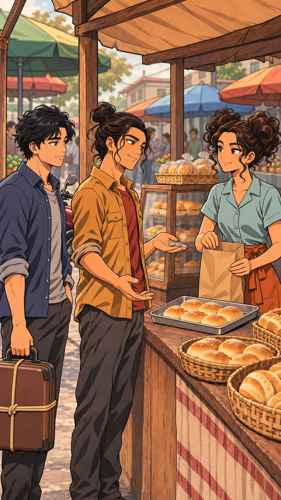](Clip-07-Bakery-Moy-Bagwis-Ning.png)

## Clip 08

[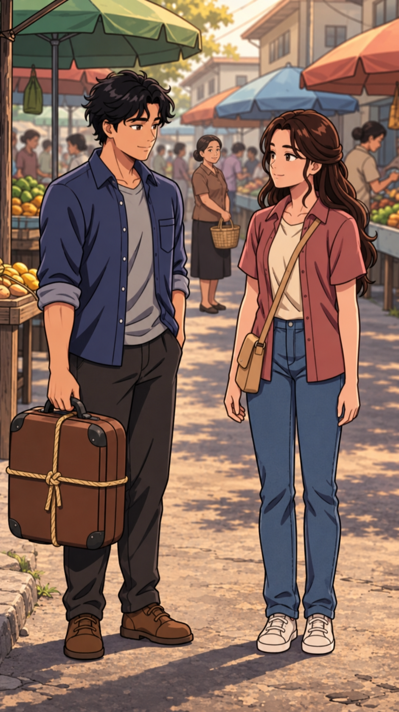](Clip-08-Market-Exit-Watcher.png)

## Clip 09

[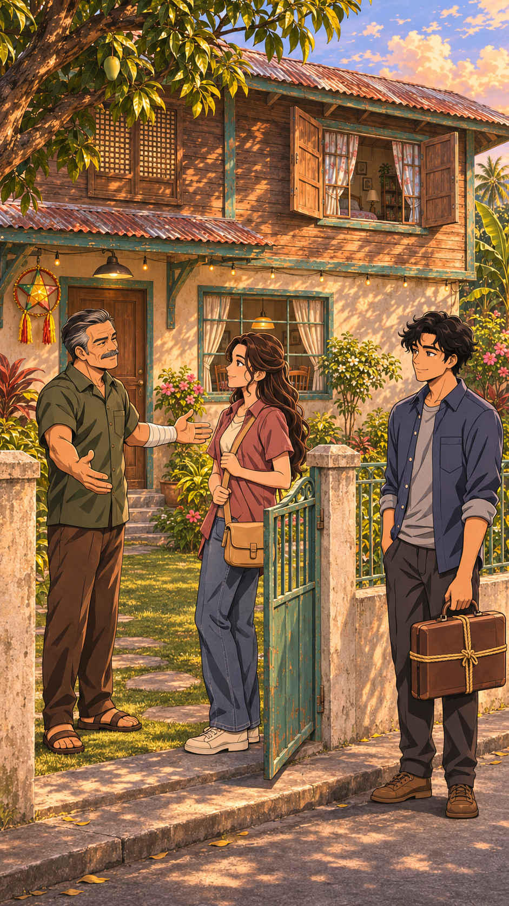](Clip-09-Homecoming-Open-Gate.png)

## Clip 10

[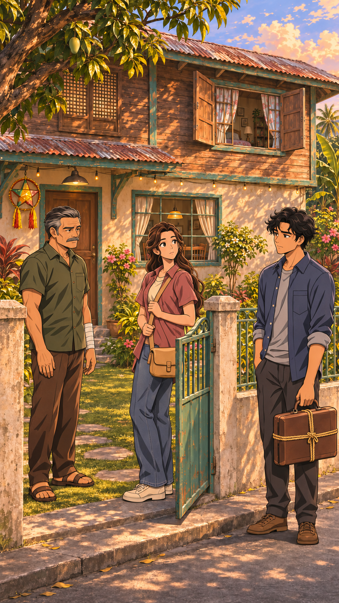](Clip-10-Guarded-Gate-Conversation.png)

## Clip 11

[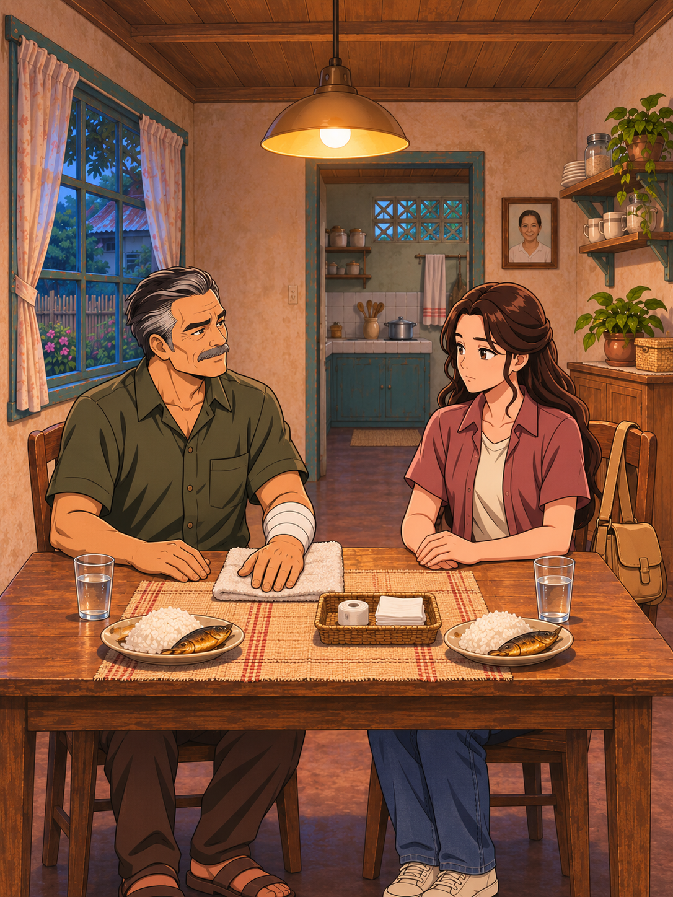](Clip-11-Dining-Bandaged-Left-Arm.png)

## Clip 12

[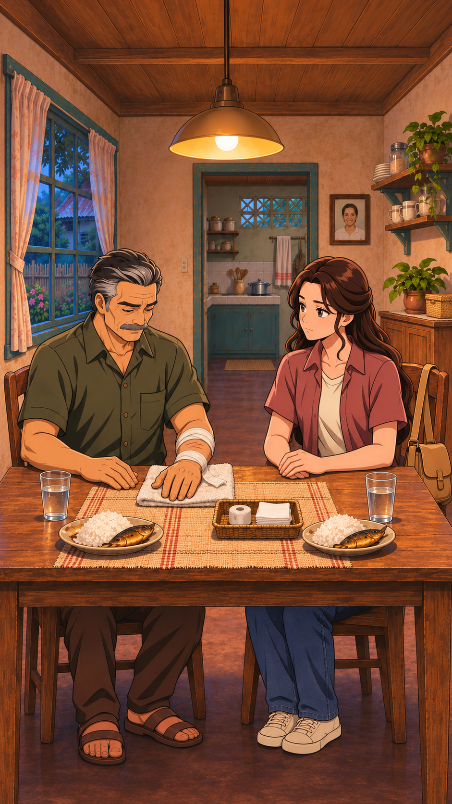](Clip-12-Dining-Loosened-Dressing.png)

## Clip 13

[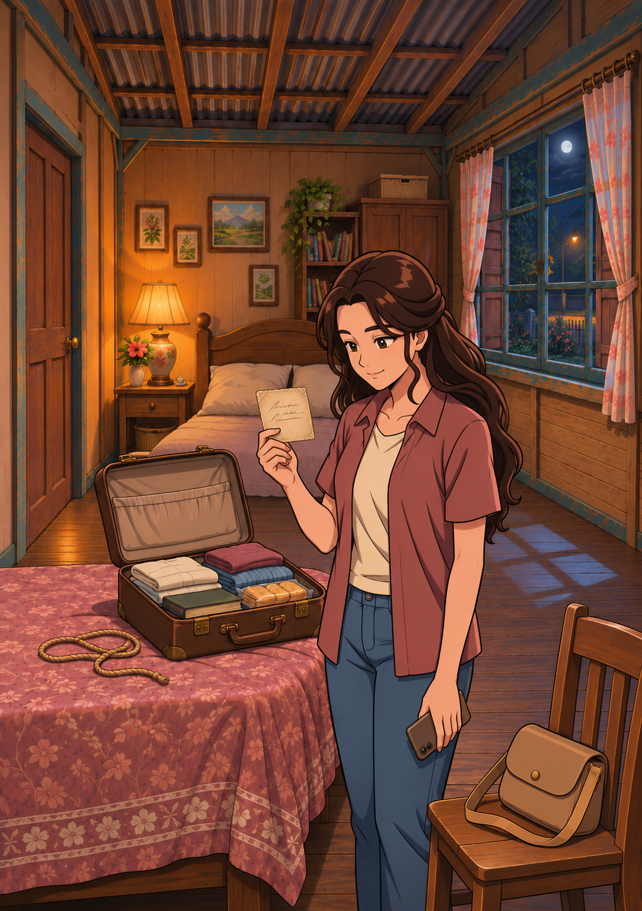](Clip-13-Bedroom-Photo-And-Phone.png)

## Clip 14

[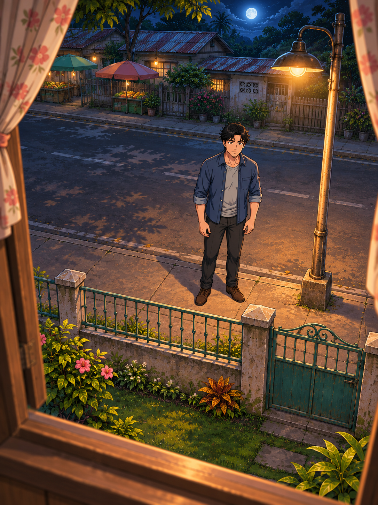](Clip-14-Bagwis-Outside-Fence.png)

## Clip 15

[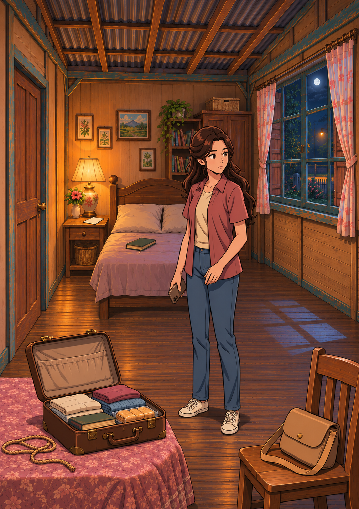](Clip-15-Bedroom-Closed-Door.png)

## Clip 16

[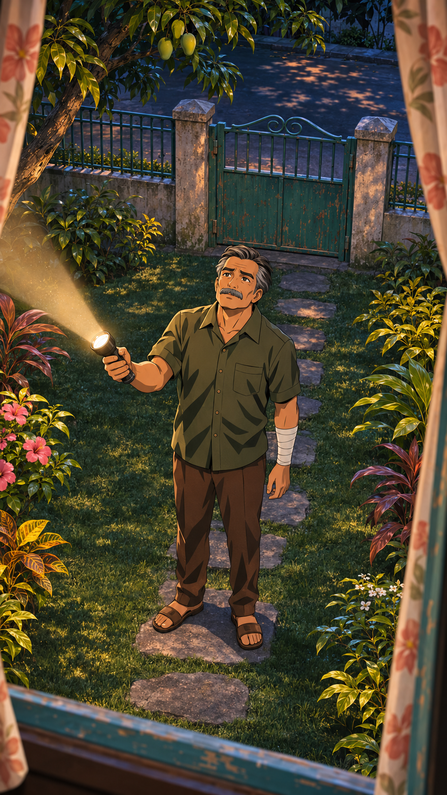](Clip-16-Tomas-Inside-Garden.png)
